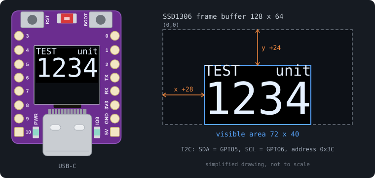

# ESP32-C3 mini — built-in 0.42" OLED reference

Minimal example and reusable driver for the ESP32-C3 mini board with the
built-in 0.42" OLED.



## Display facts

| Item | Value |
|---|---|
| Controller | SSD1306, 128×64 frame buffer |
| Visible area | 72×40 px, starts at buffer (28, 24) |
| Bus | I2C, SDA = GPIO5, SCL = GPIO6, address 0x3C, no reset pin |
| Library | Adafruit SSD1306 + Adafruit GFX |

Text with the built-in font: size 1 = 6×8 px per char (12 chars × 5 rows),
size 2 = 12×16 px (6 chars × 2 rows), size 3 = 18×24 px (4 chars × 1 row).

## Files

```
include/oled_config.h   pins, address, buffer size, visible window + offset
include/mini_oled.h     MiniOled class (local 72x40 coordinates)
src/mini_oled.cpp       implementation
src/main.cpp            demo: frame test, text rows, big value, bar + IP
```

## Using it in another project

Copy `oled_config.h`, `mini_oled.h`, `mini_oled.cpp`, add the two `lib_deps`
from `platformio.ini`, then:

```cpp
#include "mini_oled.h"
MiniOled oled;

void setup() { oled.begin(); }
void loop() {
    oled.clear();
    oled.text(0, 0, "TEST");           // (0,0) = top-left visible pixel
    oled.textCentered(12, "1234", 3);
    oled.show();                       // nothing appears until show()
}
```

`oled.raw()` gives the full Adafruit API, but in buffer coordinates
(add 28 to x and 24 to y).

## Build / upload

```
pio run -t upload
pio device monitor
```

The first demo screen draws a frame with dots in all four corners. If any part
of the frame is cut off, the offset in `oled_config.h` is wrong for your board.

## License

MIT, see [LICENSE](LICENSE).
